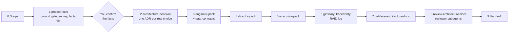

# How it works

## The flow

`architecture-docs` orchestrates. Each phase calls a focused skill.

Packs are written bottom-up so the summaries summarize real detail.

## One source of truth

`docs/architecture/00-project-facts.yaml` holds every fact: the ground gate,
KPIs, NFRs, sources, data products, pipelines, decisions, costs (with basis and
price date), timeline, team, risks, assumptions and open questions. Docs cite
facts by ID. A changed fact gets changed there first, then in every doc that
uses it. The validator fails any reference to an ID that is not defined.

## The ground gate

From The Data Warrior. Six questions, one per turn, before anything is written:
decision, outcome, terrain, falsifiers, owner, single action in one sentence.
If the single action will not fit in one sentence, the work is not ready to
document, and the skill says so.

## Decisions

Every real choice gets an ADR: at least two options plus the status quo, CDC
versus watermarks for ingestion, a steelman of the rejected option, and a
falsifiable validation test. Each ADR carries the one-line version the exec
pack uses.

## Reviews

| Pack | Reader subagent | Specialists |
|---|---|---|
| Executive | cio-reader | |
| Director | data-director-reader | reliability, security and compliance |
| Engineer | lead-engineer-reader | data architect, analytics engineer, infrastructure |
| Whole set | council (six Data Warrior lenses) | |

Subagents are read-only and return a verdict. When the host can run them as
separate subagents, the reviews are independent and say so. When it cannot,
one agent applies each persona and labels the reviews as perspectives.

## Roles

A `Role:` line in the target repo's `AGENTS.md` or `CLAUDE.md` changes the
collaboration style: Deshi (teach), Rōnin (act within scope, the default),
Kensei (anticipate system-wide effects). Roles never grant permissions.

## Generated files

Edit the source, then run `python3 scripts/build.py`:

| Source | Generates |
|---|---|
| `plugins/data-architecture-docs/shared/conventions.md` | `references/conventions.md` in every first-party skill |
| `plugins/data-architecture-docs/plugin.meta.json` | both plugin manifests |
| `marketplace.meta.json` + `plugins/*` | both marketplace files |
| `scripts/upstreams.json` (via `sync_upstream.py`) | vendored plugins and their manifests |

CI fails if any generated file is out of date.
