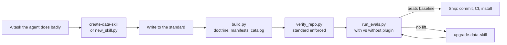
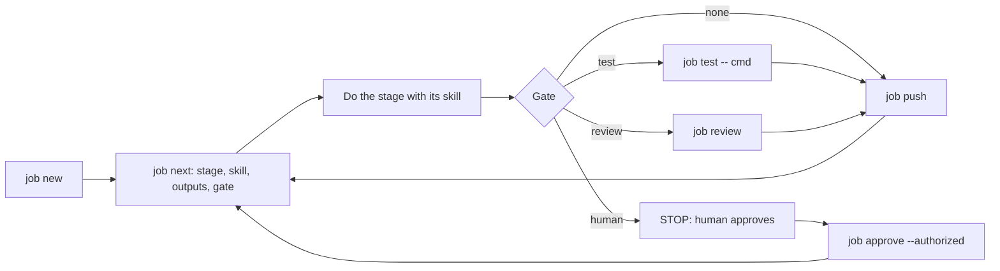

# How the factory works

## The loop

## Two halves: skills and the line

- **Skills** carry the know-how: how a senior engineer reverse engineers a proc,
  builds an incremental model, or plans a migration.
- **The line** (`de-factory-line`, `job.py`) carries the discipline: a job moves
  through stages defined in `job-types.json`; each stage names its skill and the
  files it must leave. Gates: **test** (a recorded exit code 0 after the stage's
  latest change), **review** (a PASS review; stale if any covered file changes),
  **human** (only `approve --authorized`, which re-checks earlier tests and
  reviews). State, hashes and logs live in the work repo under `.factory/`.

## Layers

| Layer | Where | Role |
|---|---|---|
| Doctrine | `factory/doctrine.md` (from The Data Warrior) | Built into every first-party skill. How we work |
| Standard | `factory/SKILL_STANDARD.md` | What every skill must contain. Enforced by `verify_repo.py` |
| Skills | `plugins/de-*/skills/` | The procedures, with references, assets and tested scripts |
| Evals | `evals/` | Proof each skill changes behavior |
| Distribution | marketplace files, `install.py` | Claude Code marketplace, Cursor local plugins, skills-only copies |

## Generated files

Never hand-edit these. Edit the source and run `python3 scripts/build.py`.

| Source | Generates |
|---|---|
| `factory/doctrine.md` | `references/doctrine.md` in every first-party skill |
| `plugins/
/plugin.meta.json` (`build.references`, `build.files`) | both plugin manifests; extra files copied into skills (conventions, skill standard, templates) |
| `marketplace.meta.json` + `plugins/*` | both marketplace files |
| every SKILL.md | `catalog/SKILLS.md`, `catalog/skills.json` |
| `scripts/upstreams.json` via `sync_upstream.py` | vendored plugins and their manifests |

CI fails if any generated file is stale.

## How the plugins route to each other

Skills name their neighbors under "Not for", so the agent moves to the right one:
reverse engineering hands off to `legacy-to-dbt-migration` and
`architecture-docs`; ingestion hands off to `backfill-and-replay`; quality hands
off to `data-observability` and `pipeline-incident-response`. The doctrine points
at the Data Warrior's `know-the-ground` whenever the decision is unclear.

## The architecture docs flow

`architecture-docs` orchestrates: `project-facts` (ground gate and facts file),
`architecture-decision` (ADRs), `engineer-pack`, `director-pack`,
`executive-pack`, `data-contracts`, `validate-architecture-docs`, and
`review-architecture-docs` (read-only reviewer subagents: CIO, Director and Lead
DE readers, the Council lenses, and five specialists).

## Evals, honestly

Regex grading is a screen, not a verdict. `run_evals.py` saves every transcript;
read failures before concluding. Results vary run to run; repeat close calls.
