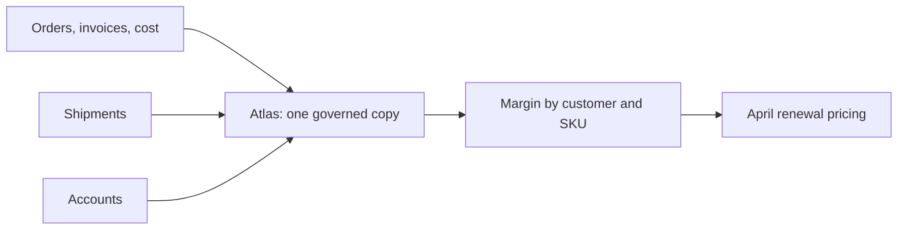

# Atlas: Strategic Architecture Overview

## In one paragraph
Atlas pulls orders, invoices and costs from the ERP, shipments from the
warehouse system and accounts from the CRM into one governed copy of company
data. Finance and Sales read margin by customer and SKU from it every morning,
and every number ties back to the general ledger. It is deliberately small:
three sources, one report family, a team of two.

## The picture

## What changes for the business
| Today | After |
|---|---|
| Two analysts build margin by hand each month | Margin is ready by 6am every business day |
| Spreadsheet margin does not tie to the ledger | Ties to the ledger within half a percent |
| Renewals priced on last year's terms | Renewals priced on real margin |

## Capabilities we gain
- Margin by customer and SKU, daily
- Seven years of history, so we can compare renewals year over year
- One definition of margin, owned by the Controller

## What we retire
The monthly margin workbook and about 72 analyst hours a month (KPI-002).

## Why this approach
| Decision | Why | Instead of |
|---|---|---|
| Microsoft Fabric (ADR-0001, proposed) | Uses the reporting and sign-in tools we already own; a team of two can run it | A separate warehouse plus new BI tooling |

## Principles
- One definition per metric, written down before it is built.
- Reconcile to the ledger before adding scope.
- Buy commodity plumbing; build only what is ours.

## Change log
| Version | Date | Author | Change |
|---|---|---|---|
| 0.1.0 | 2026-11-19 | Director of Data | First draft (example) |
