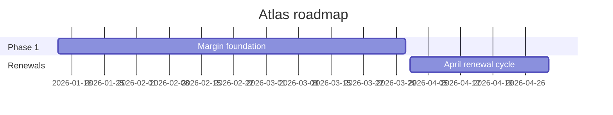

# Atlas: Investment and Roadmap

## Summary
$180K to build and $62K a year to run: $304K over three years. The first value
lands before the April renewal cycle. All figures are fictional example numbers.

## Spend by year
| | Year 1 | Year 2 | Year 3 | Basis |
|---|---|---|---|---|
| One-time build | $180K | | | Contract engineer 6 months, setup, training |
| Platform run | $62K | $62K | $62K | Capacity and storage, prices as of Nov 19, 2026 |
| **Total** | **$242K** | **$62K** | **$62K** | Existing team salaries not included |

## Value
| Value driver | Type | Estimate | Confidence |
|---|---|---|---|
| +1.5 points margin on renewed contracts (KPI-001) | Hard | Depends on renewal volume | Medium |
| 72 analyst hours a month back (KPI-002) | Soft | About 860 hours a year | High |

> OPEN QUESTION [Q-001]: Is the $62K run budget in the FY27 IT plan or new spend? (Owner: CFO, Needed by: Jan 15)

## Roadmap

## Milestones to report upward
| Milestone | Target date | Business meaning |
|---|---|---|
| ERP feed live | Jan 31 | Orders and invoices land daily |
| Margin reconciles to ledger | Feb 28 | The number can be trusted |
| Sales walkthrough done | Mar 31 | Ready for April pricing |

## What could move the dates or the cost
- Cost allocation rules take longer to document than February (RSK-001).
- ERP change tracking cannot be enabled (A-001).

## Change log
| Version | Date | Author | Change |
|---|---|---|---|
| 0.1.0 | 2026-11-19 | Director of Data | First draft (example) |
