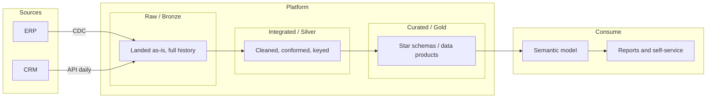
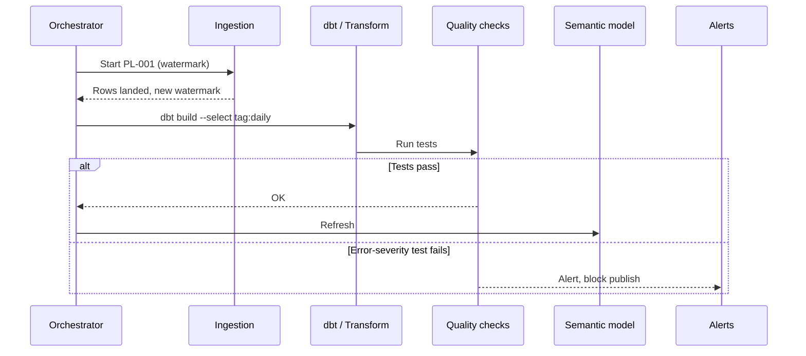

# Diagram Standards

All diagrams are Mermaid in fenced ```mermaid blocks. No images, no PlantUML, no
draw.io unless the user asks.

## Required diagrams by doc

| Doc | Diagram | Mermaid type | Max nodes |
|---|---|---|---|
| EXE-02 | Business context (sources -> platform -> outcomes) | `flowchart LR` | 7 |
| EXE-03 | Roadmap | `gantt` (quarters) | 6 bars |
| DIR-01 | Logical architecture (layers x domains) | `flowchart LR` with subgraphs | 20 |
| DIR-01 | Data product map | `flowchart TB` | 15 |
| DIR-05 | Delivery plan | `gantt` (months) | 15 bars |
| ENG-01 | Physical architecture (workspaces, storage, compute, network) | `flowchart LR` with subgraphs | 30 |
| ENG-01 | Key flow sequence (ingest -> transform -> publish -> alert) | `sequenceDiagram` | - |
| ENG-02 | ERD per subject area | `erDiagram` | 12 entities each |
| ENG-03 | Pipeline DAG per pipeline group | `flowchart TB` | 20 |
| ENG-06 | Environment promotion | `flowchart LR` | 12 |
| ENG-08 | Incident flow | `flowchart TD` or `stateDiagram-v2` | 12 |

## Conventions

- Direction: data flows left to right (`LR`). Hierarchy top to bottom (`TB`).
- Exec diagrams use business labels only. No tool names unless the tool IS the decision.
- Director diagrams use logical names: "Raw / Bronze", "Integrated / Silver", "Curated / Gold", "Semantic".
- Engineer diagrams use real names: workspace names, lakehouse/warehouse names, schemas.
- Subgraph per layer or per environment. Label subgraphs explicitly.
- Edge labels state the mechanism: `-->|CDC every 15m|`, `-->|dbt build 05:00|`.
- Keep node IDs short and stable (`src_erp`, `brz_erp`, `slv_customer`).
- Avoid styling unless it encodes meaning. If you use classDef, use it for one thing
  only (example: highlight new components vs existing).
- After writing a diagram, re-read it as the persona. If they would need to ask
  "what is that box?", relabel it.

## Skeletons

Logical architecture:



Key flow sequence:


