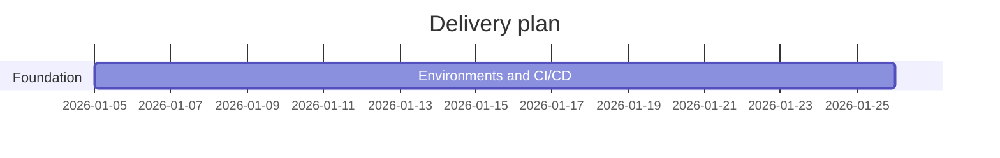

# {{project_name}}: Delivery Plan

## Summary

## Phases
| Phase | Dates | Scope | Value delivered | Exit criteria |
|---|---|---|---|---|

## Workstreams
| Workstream | Lead | Key deliverables |
|---|---|---|

## Dependencies
| Dependency | On whom | Needed by | Status |
|---|---|---|---|

## Capacity
<!-- Team allocation per phase vs estimated effort. Call out the gap honestly. -->
| Phase | Estimated effort (person-weeks) | Available | Gap | Plan |
|---|---|---|---|---|

## Source onboarding order
<!-- Order and why (value, complexity, dependency). -->
| Order | SRC | Reason | Target phase |
|---|---|---|---|

## Definition of done (platform level)
<!-- Per data product: built, tested, documented, secured, monitored, consumer signed off. -->

## Change log
| Version | Date | Author | Change |
|---|---|---|---|
