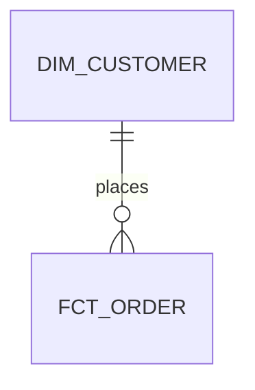

# {{project_name}}: Physical Data Model

## 1. Conventions
- Naming: link ENG-09. Example: `stg_<src>__<entity>`, `dim_<entity>`, `fct_<process>`.
- Keys: surrogate key method (hash of business key with defined casing/trim/delimiter, or identity).
- Time: all timestamps stored in UTC as `<name>_utc`; business dates as `date`.
- SCD policy: which dimensions are Type 1, which Type 2, and the SCD2 columns (`valid_from`, `valid_to`, `is_current`).
- Unknown/late members: default `-1` row (or ghost record) policy.

## 2. Layer object inventory
| Layer | Schema | Object | Type | Grain | Primary key | Materialization | Partition / cluster |
|---|---|---|---|---|---|---|---|

## 3. Subject area: {{subject_area}}

### 3.1 {{table_name}}
- **Grain**: one row per ...
- **Primary key**: ...
- **Sources**: SRC-###
- **Load**: incremental on ..., merge on ...
- **History**: SCD Type ...

| Column | Type | Nullable | Description | PII | Source / rule |
|---|---|---|---|---|---|

```sql
-- DDL or dbt model skeleton
```

## 4. Conformed dimensions
| Dimension | Used by facts | Business key | SCD | Owner |
|---|---|---|---|---|

## 5. Partitioning, clustering and maintenance
<!-- Per large table: partition column, clustering/Z-order/liquid clustering, file size targets, OPTIMIZE/VACUUM schedule. -->

## 6. Schema evolution policy
<!-- Additive changes allowed how; breaking changes require new contract version; deprecation window. -->

## Change log
| Version | Date | Author | Change |
|---|---|---|---|
