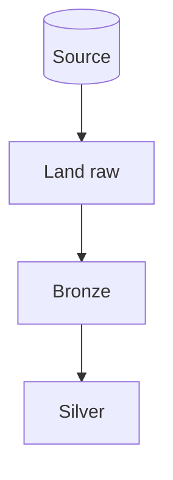

# {{project_name}}: Pipeline Specifications

## Pipeline index
| PL | Name | Source | Pattern | Schedule | Target | Owner | Status |
|---|---|---|---|---|---|---|---|

---

## PL-###: {{pipeline_name}}

| Field | Value |
|---|---|
| Source | SRC-### ({{system}}), objects: ... |
| Pattern | CDC / watermark / full snapshot / API / file |
| Tool | |
| Schedule / trigger | |
| Must complete by | (ties to NFR-###) |
| Target | layer.schema.table(s) |
| Incremental key | column, type, timezone |
| Watermark storage | where the high-water mark lives and how it advances |
| Idempotency | what makes a re-run safe (partition overwrite, merge on key, batch id dedupe) |
| Late-arriving data | lookback window, how corrections are applied |
| Deletes at source | soft delete flag / tombstones / periodic full compare |
| Schema drift | detect how; add-column behavior; breaking-change behavior |
| Retries | count, backoff, timeout |
| Partial failure | what state is left, how to resume |
| Backfill | command / parameters, max safe range, impact on capacity |
| Data quality gates | TST-### list, severity |
| Contract | ENG-04 contract id |
| Alerts | condition -> channel |
| Expected volume | rows per run, runtime |
| Owner / on-call | |

### Flow


### Logic notes
<!-- Anything non-obvious: dedupe rules, timezone handling, business key derivation. -->

### Backfill runbook
```bash
# exact command(s)
```

---

## Change log
| Version | Date | Author | Change |
|---|---|---|---|
