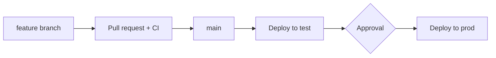

# {{project_name}}: Environments and CI/CD

## 1. Environment topology
| Env | Purpose | Location (workspace / account / catalog) | Data | Who has write |
|---|---|---|---|---|
| dev | | | sample / masked | engineers |
| test | | | prod-like | CI service principal |
| prod | | | real | CD service principal only |



## 2. Source control
- Repo layout:
```text
/ingestion  /transform (dbt)  /orchestration  /semantic  /infra  /docs
```
- Branching: trunk-based with short-lived feature branches (or state otherwise).
- What is source-controlled vs not, per platform item type.

## 3. CI pipeline (on PR)
| Step | Command / action | Fails PR when |
|---|---|---|
| Lint SQL | `sqlfluff lint` | any error |
| Lint Python | `ruff check` | any error |
| Build changed models | `dbt build --select state:modified+ --defer --state <prod-manifest>` | any error-severity test |
| Docs check | validate_docs.py | errors |

## 4. CD pipeline (on merge / release)
<!-- Exact steps per environment, approvals, deployment tool, parameter swaps (connections, capacities, workspace ids). -->

## 5. Secrets and configuration
<!-- Key Vault / secrets manager, service principals, rotation, per-env config files. No secrets in repo. -->

## 6. Infrastructure as code
<!-- What is Terraform/Bicep managed, state location, plan/apply approvals. -->

## 7. Rollback
<!-- How to roll back code, how to roll back data (time travel, re-run from bronze). -->

## Change log
| Version | Date | Author | Change |
|---|---|---|---|
