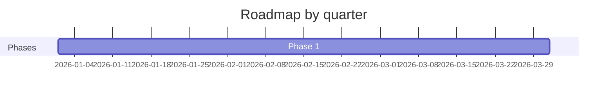

# {{project_name}}: Investment and Roadmap

## Summary
<!-- Total 3-year cost, when value lands, payback logic if known. -->

## Spend by year
| | Year 1 | Year 2 | Year 3 | Basis |
|---|---|---|---|---|
| Platform / licensing | | | | |
| People (internal) | | | | |
| Partners / contractors | | | | |
| **Total** | | | | |

Prices as of {{price_date}}. Detail in DIR-06.

## Value
<!-- Tie to KPIs. Hard savings vs soft value, labeled honestly. -->
| Value driver | Type (hard/soft) | Estimate | Confidence |
|---|---|---|---|

## Roadmap

## Milestones you can report upward
| Milestone | Target date | Business meaning |
|---|---|---|

## What could move the dates or the cost
<!-- 3 bullets max. -->

## Change log
| Version | Date | Author | Change |
|---|---|---|---|
