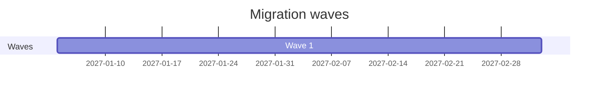

# Migration roadmap

## Waves

| Wave | Delivers (data products, consumers) | Retires (legacy objects) | Window | Owner |
|---|---|---|---|---|
| 1 | | | | |

## Wave <n>: <name>

| Field | Value |
|---|---|
| Scope | |
| Dependencies | |
| Effort vs capacity | |
| Parity tests | |
| Parallel run | length, includes a month end? |
| Cutover steps | |
| Rollback steps | |
| Decommission steps | disable, wait, archive, remove, each approved |
| Exit criteria | |
| Sign-off | |

## Business calendar constraints

| Period | Constraint |
|---|---|

## Kill criteria

| Signal | Threshold | Action |
|---|---|---|

## Timeline

